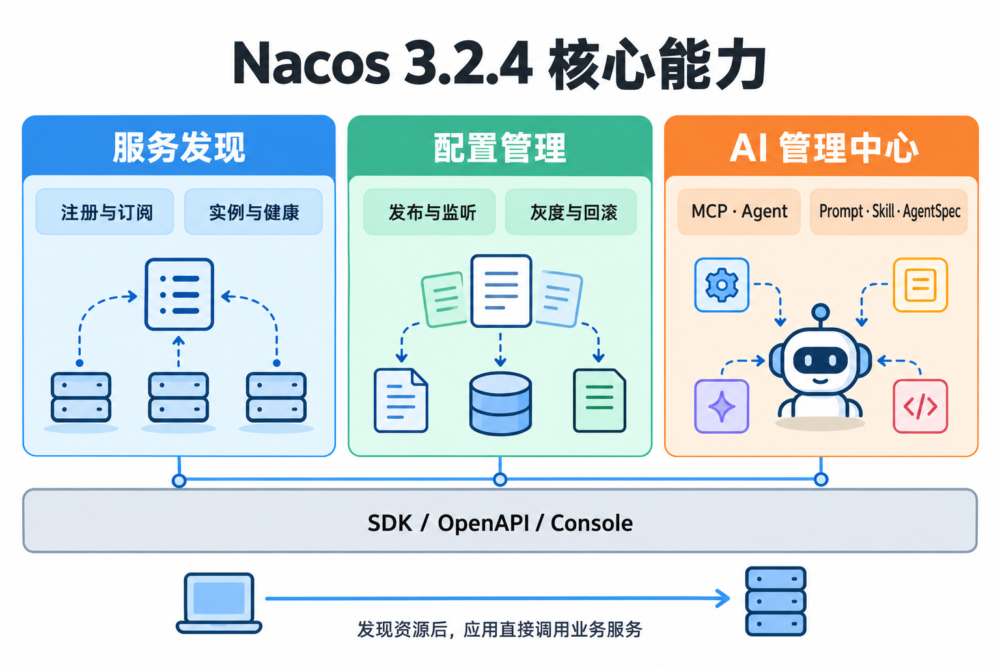

# Nacos 概念与版本基线

Nacos 3 为应用提供动态服务发现、集中配置管理和 AI 资源的注册与治理能力。

> [!abstract]
> 本课重点：区分注册中心和配置中心；认识架构分层与生态；建立 3.2.4 的版本基线。

## 三类能力

| 能力 | 解决的问题 | 示例 |
| --- | --- | --- |
| 注册中心 | 调用方怎样找到变化中的服务实例 | 通过 <code>service-product</code> 找到商品服务 IP 和端口 |
| 配置中心 | 多个应用怎样统一读取并更新配置 | 调整功能开关、超时、限流参数 |
| AI 管理中心 | AI 应用怎样发现和管理运行时资源 | MCP Server、Agent、Prompt、Skill、AgentSpec |

注册中心保存的是**服务实例信息**，配置中心保存的是**配置内容**。它们可以共用一套 Nacos，但资源身份、数据生命周期和一致性路径不同。



## 架构分层与生态

| 层次 | 主要组成 | 解决的问题 |
| --- | --- | --- |
| 使用入口 | SDK、Client / Admin OpenAPI、Console、运维 SDK / CLI | 业务接入、发布与管理 |
| 业务能力 | Naming、Config、AI 管理中心 | 实例发现、配置分发与 AI 资源治理 |
| 内核与运行时 | 通信、事件、缓存、成员管理、协议与持久化路径 | 推送、状态恢复、节点协调与存储 |
| 插件扩展 | 鉴权、可见性、数据源、加密、寻址、流量防护、追踪 | 按部署需求扩展平台能力 |

这些是理解架构的逻辑层次，不是要求部署成四个独立进程。成员管理负责识别节点，协议负责数据协调，日志与指标帮助定位问题，业务模块按资源模型提供 API。

| 生态 | 常见接入方式 |
| --- | --- |
| Spring Cloud / Dubbo | SDK 或框架 starter 接入服务发现、配置 |
| Kubernetes / CoreDNS | 通过相应控制器或生态组件同步服务、提供 DNS 能力 |
| Istio / Prometheus | 使用对应集成下发资源或提供监控服务发现 |
| AI 应用 / 网关 | MCP、A2A、Prompt 等资源发现与治理 |

DNS 和代理能力要看具体生态组件，不能把它们都当成默认 Server 内置能力。AI 管理中心的 A2A Agent 表示可被发现和调用的 Agent 资源。

## 一次服务调用

```text
商品服务 → Nacos：注册 service-product 的实例地址
订单服务 → Nacos：订阅 service-product 的实例列表
订单服务 → 客户端负载均衡：选择一个实例
订单服务 → 商品服务：直接发送 HTTP 请求
```

Nacos 不转发这次业务 HTTP 请求。服务发现解决“在哪里”，负载均衡解决“选哪个”，超时、重试和熔断由调用框架与应用负责。

## 组件与版本

| 组件 | 职责 | 本课程基线 |
| --- | --- | --- |
| Nacos Server | 服务注册、配置存储、长连接通信 | <code>3.2.4</code> |
| Nacos Console | 管理页面和控制台接口 | 发行包附带的 <code>3.2.4</code> Console |
| Nacos Client | 业务应用内的 SDK | Spring 项目由 Spring Cloud Alibaba BOM 管理 |
| Maintainer SDK | 管理资源、发布配置和执行运维操作 | 使用适配 Server 3.2.4 的 Nacos 3 运维 SDK |

截至 **2026-10-03**，官方 GitHub 的最新稳定发布为 **3.2.4**，发布日期为 **2026-08-27**。本课程固定这个版本，不使用会随时间变化的下载地址或镜像标签来定义示例。

> [!note]
> Spring 工程使用 Alibaba 2025.1 BOM 管理的 Nacos Client 3.1.1，与本课 Server 3.2.4 配合；独立 SDK 程序按所需 Nacos 3 功能选择依赖。两者职责不同，版本号不要求完全相同。

## Java 要求

| 运行对象 | 官方发布说明要求 | 学习建议 |
| --- | --- | --- |
| Server / Console | Java 17 | 使用 64 位 JDK 17 或经过验证的更新 JDK |
| Nacos Client | Java 8 | Spring 示例仍服从 Spring Boot 的 JDK 要求 |
| Maintainer Client | Java 8 | 运维程序按自身框架选择 JDK |

本课程的 Server、Console 和 Spring Boot 应用统一准备 64 位 JDK 17 或经过验证的更新 JDK。

## Nacos 3 接入要点

| 项目 | 本课程采用的做法 |
| --- | --- |
| 控制台 | 默认 <code>http://&lt;NACOS_HOST&gt;:8080</code>，主机由读者填写 |
| 管理员 | 首次初始化密码，业务应用使用单独授权的账号 |
| 通信入口 | 区分主端口、SDK gRPC、节点间通信、Console |
| Spring 配置 | 在 <code>application.yml</code> 中显式声明 <code>spring.config.import</code> |
| 实例存活 | gRPC SDK 依赖连接状态；HTTP 临时实例需要续约 |
| HTTP 接口 | 使用 <code>/v3/client</code>、<code>/v3/admin</code> 和对应鉴权接口 |

详见 [[02-Windows单机部署与鉴权|Windows 部署]]、[[09-通信机制与一致性原理|通信与一致性]]、[[14-版本升级与旧文纠偏|版本升级与迁移]]。
