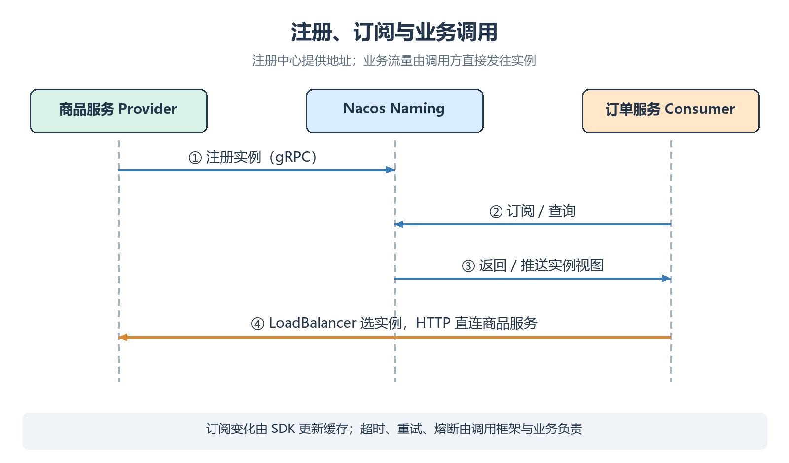

# Spring Cloud 服务注册与调用

Spring Cloud Alibaba 把 Nacos 接入 Spring Cloud 的服务注册与发现体系，调用方再通过 LoadBalancer 选择实例。

> [!abstract]
> 本课重点：Boot 4 依赖组合；服务注册与双实例调用；RestClient、OpenFeign 与降级。

## 版本与工程

本课固定官方版本表中的组合，Nacos Server 使用 <code>3.2.4</code>：

| 组件 | 版本 / 选择 |
| --- | --- |
| JDK | <code>17+</code>；本课代码使用 Java 17 语法 |
| Spring Boot | <code>4.0.0</code> |
| Spring Cloud | <code>2025.1.0</code> |
| Spring Cloud Alibaba | <code>2025.1.0.0</code> |
| BOM 管理的 Nacos Client | <code>3.1.1</code> |
| HTTP 客户端 | Spring <code>RestClient</code> |

示例用商品 / 订单两个服务演示调用链。这里采用 **Boot 4 依赖组合**，父 POM、Spring Cloud 和 Alibaba BOM 使用本课列出的同一组合；架构基础见 [[分布式基础|分布式基础]]。

创建两个独立 Maven 工程 <code>service-product</code>、<code>service-order</code>，或者在新的 Boot 4 多模块工程中建立这两个模块。



## POM

下面是商品工程的完整 <code>pom.xml</code>；订单工程只需把 <code>artifactId</code> 改成 <code>service-order</code>。

```xml
<project xmlns="http://maven.apache.org/POM/4.0.0"
         xmlns:xsi="http://www.w3.org/2001/XMLSchema-instance"
         xsi:schemaLocation="http://maven.apache.org/POM/4.0.0 https://maven.apache.org/xsd/maven-4.0.0.xsd">
    <modelVersion>4.0.0</modelVersion>
    <parent>
        <groupId>org.springframework.boot</groupId>
        <artifactId>spring-boot-starter-parent</artifactId>
        <version>4.0.0</version>
        <relativePath/>
    </parent>
    <groupId>com.example</groupId>
    <artifactId>service-product</artifactId>
    <version>1.0.0</version>
    <properties><java.version>17</java.version></properties>
    <dependencyManagement>
        <dependencies>
            <dependency>
                <groupId>org.springframework.cloud</groupId>
                <artifactId>spring-cloud-dependencies</artifactId>
                <version>2025.1.0</version>
                <type>pom</type><scope>import</scope>
            </dependency>
            <dependency>
                <groupId>com.alibaba.cloud</groupId>
                <artifactId>spring-cloud-alibaba-dependencies</artifactId>
                <version>2025.1.0.0</version>
                <type>pom</type><scope>import</scope>
            </dependency>
        </dependencies>
    </dependencyManagement>
    <dependencies>
        <dependency>
            <groupId>org.springframework.boot</groupId>
            <artifactId>spring-boot-starter-webmvc</artifactId>
        </dependency>
        <dependency>
            <groupId>com.alibaba.cloud</groupId>
            <artifactId>spring-cloud-starter-alibaba-nacos-discovery</artifactId>
        </dependency>
        <dependency>
            <groupId>org.springframework.cloud</groupId>
            <artifactId>spring-cloud-starter-loadbalancer</artifactId>
        </dependency>
    </dependencies>
    <build>
        <plugins>
            <plugin>
                <groupId>org.springframework.boot</groupId>
                <artifactId>spring-boot-maven-plugin</artifactId>
            </plugin>
        </plugins>
    </build>
</project>
```

Boot 4 示例使用 <code>spring-boot-starter-webmvc</code>。Starter 不单独写版本，Client 也不手工覆盖成 Server 的 <code>3.2.4</code>。

## 商品服务

创建 <code>src/main/resources/application.yml</code>：

```yaml
server:
  port: 9001
spring:
  application:
    name: service-product
  cloud:
    nacos:
      discovery:
        server-addr: ${NACOS_SERVER_ADDR}
        namespace: public
        group: DEFAULT_GROUP
        username: ${NACOS_USERNAME}
        password: ${NACOS_PASSWORD}
        ephemeral: true
```

在 [[02-Windows单机部署与鉴权|部署课]] 的控制台为学习账号授权；在启动应用的 PowerShell 中设置当前会话凭据：

```powershell
$env:NACOS_USERNAME = Read-Host 'Nacos业务账号'
$env:NACOS_PASSWORD = Read-Host 'Nacos业务密码' -MaskInput
$env:NACOS_SERVER_ADDR = '<NACOS_HOST>:8848' # 替换主机地址，使用Server主端口
```

输入值只保留在当前进程环境；应用启动后会继承。每个新终端都要设置，不把真实密码写入 YAML。

创建 <code>src/main/java/com/example/product/ProductApplication.java</code>：

```java
package com.example.product;

import java.util.Map;
import org.springframework.beans.factory.annotation.Value;
import org.springframework.boot.SpringApplication;
import org.springframework.boot.autoconfigure.SpringBootApplication;
import org.springframework.web.bind.annotation.GetMapping;
import org.springframework.web.bind.annotation.PathVariable;
import org.springframework.web.bind.annotation.RestController;

@SpringBootApplication
@RestController
public class ProductApplication {
    @Value("${server.port}")
    private int port;

    public static void main(String[] args) {
        SpringApplication.run(ProductApplication.class, args);
    }

    @GetMapping("/products/{id}")
    public Map<String, Object> product(@PathVariable("id") long id) {
        return Map.of("id", id, "name", "商品示例", "port", port);
    }
}
```

有 Discovery starter 后，自动配置会注册服务；这个示例不需要额外添加 <code>@EnableDiscoveryClient</code>。

## 订单服务

订单工程的 YAML 使用相同 Discovery 配置，把应用名改成 <code>service-order</code>、端口改成 <code>9010</code>。

创建 <code>src/main/java/com/example/order/OrderApplication.java</code>：

```java
package com.example.order;

import org.springframework.boot.SpringApplication;
import org.springframework.boot.autoconfigure.SpringBootApplication;
import org.springframework.cloud.client.loadbalancer.LoadBalanced;
import org.springframework.context.annotation.Bean;
import org.springframework.web.bind.annotation.GetMapping;
import org.springframework.web.bind.annotation.RestController;
import org.springframework.web.client.RestClient;

@SpringBootApplication
public class OrderApplication {
    public static void main(String[] args) {
        SpringApplication.run(OrderApplication.class, args);
    }

    @Bean
    @LoadBalanced
    RestClient.Builder restClientBuilder() {
        return RestClient.builder();
    }

    @RestController
    static class OrderController {
        private final RestClient client;

        OrderController(RestClient.Builder builder) {
            this.client = builder.build();
        }

        @GetMapping("/orders/demo")
        String order() {
            return client.get().uri("http://service-product/products/1")
                    .retrieve().body(String.class);
        }
    }
}
```

<code>@LoadBalanced</code> 让 URI 主机部分的 <code>service-product</code> 被当作服务名解析。没有这个配置时，它通常会被当成普通 DNS 域名。

## 启动与验证

分别在两个工程目录执行：

```powershell
mvn clean package
java -jar '.\target\service-product-1.0.0.jar'
```

订单工程启动 <code>service-order-1.0.0.jar</code>。先访问商品接口，再调用订单接口：

```powershell
Invoke-RestMethod -Uri 'http://<PRODUCT_HOST>:9001/products/1'
Invoke-RestMethod -Uri 'http://<ORDER_HOST>:9010/orders/demo'
```

控制台应在 <code>public / DEFAULT_GROUP</code> 中显示两个逻辑服务。订单响应包含商品服务的 <code>port=9001</code>。

在第三个已配置凭据的终端启动第二个商品实例：

```powershell
java -jar '.\target\service-product-1.0.0.jar' --server.port=9002
```

反复调用订单接口，观察 <code>9001</code> 与 <code>9002</code> 的响应。停止一个商品进程后，等待发现视图更新，再验证剩余实例；更新期间出现短暂失败不等于注册中心一定故障。

## OpenFeign 声明式调用与降级

如果希望用接口声明替代手写 HTTP 调用，在**订单工程**加入下面的依赖；版本仍由 Spring Cloud BOM 管理：

```xml
<dependency>
    <groupId>org.springframework.cloud</groupId>
    <artifactId>spring-cloud-starter-openfeign</artifactId>
</dependency>
<dependency>
    <groupId>org.springframework.cloud</groupId>
    <artifactId>spring-cloud-starter-circuitbreaker-resilience4j</artifactId>
</dependency>
```

创建 <code>com/example/order/ProductClient.java</code>：

```java
package com.example.order;

import org.springframework.cloud.openfeign.FeignClient;
import org.springframework.web.bind.annotation.GetMapping;
import org.springframework.web.bind.annotation.PathVariable;

@FeignClient(name = "service-product", fallbackFactory = ProductFallbackFactory.class)
public interface ProductClient {
    @GetMapping("/products/{id}")
    String product(@PathVariable("id") long id);
}
```

在订单启动类上添加 <code>@EnableFeignClients(clients = ProductClient.class)</code>，导入 <code>org.springframework.cloud.openfeign.EnableFeignClients</code>。在订单配置中显式开启 CircuitBreaker：

```yaml
spring:
  cloud:
    openfeign:
      circuitbreaker:
        enabled: true
```

创建 <code>com/example/order/ProductFallbackFactory.java</code>：

```java
package com.example.order;

import org.springframework.cloud.openfeign.FallbackFactory;
import org.springframework.http.HttpStatus;
import org.springframework.stereotype.Component;
import org.springframework.web.server.ResponseStatusException;

@Component
public class ProductFallbackFactory implements FallbackFactory<ProductClient> {
    @Override
    public ProductClient create(Throwable cause) {
        return id -> {
            throw new ResponseStatusException(
                    HttpStatus.SERVICE_UNAVAILABLE, "商品服务暂不可用", cause);
        };
    }
}
```

在上一段 <code>OrderController</code> 中增加 <code>ProductClient</code> 字段，修改构造器并加入接口：

```java
private final ProductClient productClient;

OrderController(RestClient.Builder builder, ProductClient productClient) {
    this.client = builder.build();
    this.productClient = productClient;
}

@GetMapping("/orders/feign-demo")
String feignOrder() {
    return productClient.product(1);
}
```

访问 <code>http://&lt;ORDER_HOST&gt;:9010/orders/feign-demo</code> 验证正常调用。测试环境停止全部商品实例后，观察调用失败与降级返回的 HTTP 503；不要用虚构商品数据冒充成功结果。

> [!note]
> 仅声明 <code>fallbackFactory</code> 不代表降级链已启用，还需要相应 CircuitBreaker 实现和开关。超时、熔断阈值和重试策略按业务配置；Nacos 只提供发现能力，不自动完成这些调用保护。

## 权重与集群优先

| 策略 | 配置 / 条件 | 效果 |
| --- | --- | --- |
| 默认 LoadBalancer | 使用本课依赖和 Builder | 默认策略不保证使用 Nacos 权重 |
| Nacos LoadBalancer | <code>spring.cloud.loadbalancer.nacos.enabled=true</code> | 使用 Nacos 的实例选择策略，可结合权重与同集群偏好 |
| 实例机房分组 | <code>spring.cloud.nacos.discovery.cluster-name=SH</code> | 只有策略读取此属性时才影响选择 |

权重调整需要同时验证消费者策略。元数据标签、cluster name 和权重不是独立的自动路由系统。

详见 [[03-服务模型与实例生命周期|服务模型]]、[[05-配置中心与动态刷新|配置中心]]、[[10-运维监控与故障排查|发现与调用排错]]。
