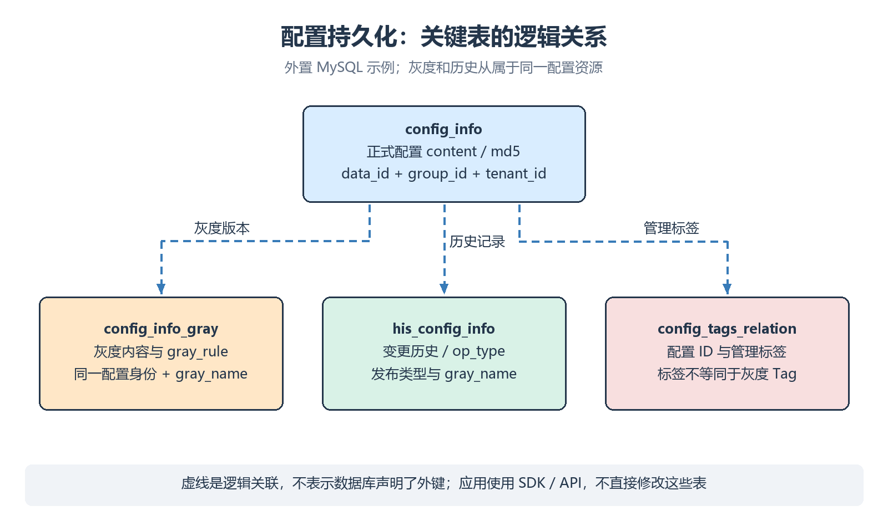

# 配置中心与动态刷新

Nacos Config 将远程配置加入 Spring Environment；配置变化后，适用的监听与刷新机制让应用读到新值。

> [!abstract]
> 本课重点：配置身份与存储模型；显式 import；RefreshScope；发布、读取、刷新验证。

## 配置资源身份

| 字段 | 本课示例 | 作用 |
| --- | --- | --- |
| Namespace | <code>public</code> | 隔离配置资源 |
| Group | <code>DEFAULT_GROUP</code> | 组织配置 |
| Data ID | <code>service-product.yml</code> | 唯一配置名的一部分 |
| 类型 | <code>YAML</code> | 内容格式与控制台编辑辅助 |

配置身份为 **namespace + group + dataId**。即使 Data ID 形似文件名，它仍是远程资源名，不会自动成为项目中的实体文件。

## 配置存储模型

外置 MySQL 的关键表以 **3.2.4 的初始化 SQL** 为准。表字段名中的 <code>tenant_id</code> 在这条配置路径中承载命名空间身份。

| 表 | 保存内容 | 关键关系 |
| --- | --- | --- |
| <code>config_info</code> | 正式配置、内容 MD5、类型与发布信息 | 唯一键为 <code>data_id + group_id + tenant_id</code> |
| <code>config_info_gray</code> | 灰度内容、规则、灰度名 | 在配置身份基础上增加 <code>gray_name</code> |
| <code>his_config_info</code> | 发布、更新、删除等历史 | 包含操作类型、发布类型与灰度信息 |
| <code>config_tags_relation</code> | 配置的管理标签关系 | 管理标签不等同于灰度 Tag 规则 |
| <code>tenant_info</code> | 命名空间元数据 | ID 与显示名称分开 |
| <code>group_capacity</code> / <code>tenant_capacity</code> | 分组 / 租户配置容量 | 用于容量治理 |



图中的关联是资源层面的逻辑关系，不表示 schema 声明了数据库外键。新部署使用 3.2.4 的初始化 SQL，灰度内容和规则由 <code>config_info_gray</code> 管理。

读取通常使用 Server 本地缓存 / Dump，应用不直接查数据库；写入使用 Console / Admin API，避免绕过历史、鉴权和变更通知。

## 发布一份配置

在控制台选择 <code>public</code> 命名空间，新建 <code>DEFAULT_GROUP / service-product.yml</code>，类型选择 YAML，内容：

```yaml
demo:
  message: 商品服务第一版配置
  discount-enabled: false
```

先发布远程资源，再启动依赖它的应用。普通业务账号只需读取权限；发布操作使用有写权限的管理账号。

## 加入依赖

在 [[04-SpringCloud服务注册与调用|上一课]] 的商品工程加入：

```xml
<dependency>
    <groupId>com.alibaba.cloud</groupId>
    <artifactId>spring-cloud-starter-alibaba-nacos-config</artifactId>
</dependency>
```

依赖由同一套 Boot 4 / Cloud 2025.1 / Alibaba 2025.1 BOM 管理，远程配置通过 <code>spring.config.import</code> 加载。

## application.yml

保留上一课 Discovery 部分，在同一个 <code>spring</code> 映射中加入 <code>config.import</code> 和 Nacos Config 参数；下面是合并后的完整配置：

```yaml
server:
  port: 9001
spring:
  application:
    name: service-product
  config:
    import:
      - 'nacos:service-product.yml?group=DEFAULT_GROUP&refreshEnabled=true'
  cloud:
    nacos:
      discovery:
        server-addr: ${NACOS_SERVER_ADDR}
        namespace: public
        group: DEFAULT_GROUP
        username: ${NACOS_USERNAME}
        password: ${NACOS_PASSWORD}
      config:
        server-addr: ${NACOS_SERVER_ADDR}
        namespace: public
        group: DEFAULT_GROUP
        username: ${NACOS_USERNAME}
        password: ${NACOS_PASSWORD}
```

Discovery 与 Config 是两条接入路径，分别配置、分别授权。两处从环境变量 <code>NACOS_SERVER_ADDR</code> 读取读者填写的 Server 地址；不要认为配置了注册中心地址就一定会读取配置中心。

| import 写法 / 参数 | 含义 |
| --- | --- |
| <code>nacos:service-product.yml</code> | 必需的远程配置；无法加载时应使启动失败 |
| <code>optional:nacos:service-product.yml</code> | 允许远程配置不可用时继续启动，需提供可接受的默认值 |
| <code>group=SHOP</code> | 此条 import 使用指定分组 |
| <code>refreshEnabled=true</code> | 此条配置参与动态刷新 |
| <code>refreshEnabled=false</code> | 启动时加载，关闭该条动态刷新 |

> [!warning]
> 本课程使用 <code>application.yml</code> 和 <code>spring.config.import</code> 接入。每份远程配置都显式声明 Data ID、分组与刷新选项；多份配置分别写成多个 import 条目。

## 可刷新的 Bean

创建 <code>src/main/java/com/example/product/ConfigController.java</code>：

```java
package com.example.product;

import java.util.Map;
import org.springframework.beans.factory.annotation.Value;
import org.springframework.cloud.context.config.annotation.RefreshScope;
import org.springframework.web.bind.annotation.GetMapping;
import org.springframework.web.bind.annotation.RestController;

@RestController
@RefreshScope
public class ConfigController {
    @Value("${demo.message}")
    private String message;

    @Value("${demo.discount-enabled:false}")
    private boolean discountEnabled;

    @GetMapping("/config/demo")
    public Map<String, Object> config() {
        return Map.of("message", message, "discountEnabled", discountEnabled);
    }
}
```

<code>@RefreshScope</code> 让刷新范围内的 Bean 在刷新后重新创建，重新解析 <code>@Value</code>。仅给一个普通单例字段加 <code>@Value</code>，不能保证它随远程变化自动重新赋值。

## 验证动态刷新

1. 重新构建并启动商品应用，访问 <code>/config/demo</code>。
2. 控制台把 <code>demo.message</code> 改成“商品服务第二版配置”，把开关改成 <code>true</code>，发布。
3. 观察客户端日志，并再次访问相同接口；正常情况下不需要重启应用。
4. 对比控制台历史，确认变更是发布到了同一资源，而不是新建了另一份配置。

```powershell
Invoke-RestMethod -Uri 'http://<PRODUCT_HOST>:9001/config/demo'
```

## 刷新的边界

| 对象 / 行为 | 是否可以直接推断会刷新 |
| --- | --- |
| RefreshScope Bean 中重新解析的属性 | 本例支持；需确认监听与刷新成功 |
| <code>@ConfigurationProperties</code> Bean | 取决于绑定方式、可变性和框架刷新支持 |
| static 字段、普通对象中保存的旧值 | 不会因为远程值变化自动同步 |
| 数据源连接池、线程池、派生客户端 | 需要专门支持或重建策略 |
| <code>server.port</code> | 发布变化不会让已启动 Web 容器自动换端口 |

业务回调先解析和校验完整的新配置，再替换运行态；非法内容不能直接破坏当前可用状态。远程发布成功与所有应用完成刷新是不同阶段。

详见 [[06-环境隔离与配置治理|多环境与治理]]、[[07-JavaSDK与v3OpenAPI|SDK 和 API]]、[[09-通信机制与一致性原理|配置通知链路]]。
