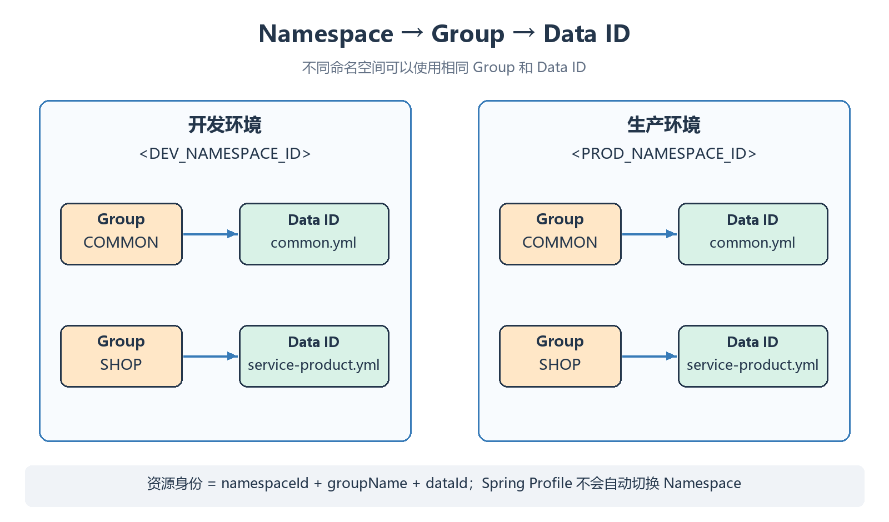

# 环境隔离与配置治理

通过命名空间、分组和显式配置导入，可以隔离开发与生产资源，再用历史、灰度和权限控制配置变更。

## 隔离层次

| 层次             | 建议用途           | 示例                                                                           |
| -------------- | -------------- | ---------------------------------------------------------------------------- |
| Namespace      | 开发、测试、生产或租户    | <code>&lt;DEV_NAMESPACE_ID&gt;</code>、<code>&lt;PROD_NAMESPACE_ID&gt;</code> |
| Group          | 环境内的业务域或应用组    | <code>SHOP</code>、<code>COMMON</code>                                        |
| Data ID        | 一份有明确职责的配置     | <code>service-product.yml</code>、<code>common.yml</code>                     |
| Spring Profile | 应用本地的环境选择与属性组织 | <code>dev</code>、<code>prod</code>                                           |

Profile 和 Namespace 是不同概念。激活 <code>prod</code> 不会自动让 Nacos 切换到生产命名空间，必须明确配置 Namespace ID。



## 命名空间 ID

在控制台新建“开发”“生产”命名空间，并记录实际 ID。应用中配置的是 **ID，不是页面显示名称**。

在 [[05-配置中心与动态刷新|上一课]] 的配置基础上，将两条路径的命名空间替换为实际 ID：

```yaml
spring:
  cloud:
    nacos:
      discovery:
        namespace: '<DEV_NAMESPACE_ID>'
      config:
        namespace: '<DEV_NAMESPACE_ID>'
```

```bash
java -jar target/service-product-1.0.0.jar --spring.profiles.active=dev
```

先在目标命名空间发布需要的配置，并给业务账号授予相应权限。注册与配置命名空间可以有意分开，但需要明确设计，不能因漏配而意外分离。

## 拆分配置

```yaml
spring:
  config:
    import:
      - 'nacos:common.yml?group=COMMON&refreshEnabled=true'
      - 'nacos:service-product.yml?group=SHOP&refreshEnabled=true'
```

| 资源 | 推荐内容 |
| --- | --- |
| <code>COMMON / common.yml</code> | 多服务共用的明确约定，避免放入某服务特有属性 |
| <code>SHOP / service-product.yml</code> | 商品服务的开关和业务参数 |
| 本地配置 / 环境变量 | Nacos 地址、身份、命名空间等启动前就需要的连接信息 |

同一 import 列表中，后面的条目通常覆盖前面条目的同名属性；导入的配置也可以覆盖声明它的本地配置文件属性。环境变量、命令行等其他 PropertySource 还可能继续覆盖，不能笼统说“Nacos 的优先级永远最高”。

尽量避免无意重复同名属性。需要确认最终值时，在受控环境检查 Spring Environment 及属性来源，不把所有配置和密码打印出来。

## 配置灰度

灰度配置从属于同一个 namespace / group / dataId，额外带有灰度版本与规则。

| 规则 | 选择依据 | 注意点 |
| --- | --- | --- |
| Beta | 客户端 IP 列表 | NAT / 代理后的地址可能与预期不同 |
| Tag | 请求或 SDK 支持的标签 | 确认客户端能够传递预期标签 |

普通读取根据规则选择灰度或正式内容；不同 API 的显式 Tag 读取语义可能不同，不能把所有“未命中”都理解为必然回退正式版本。

## 历史与回滚

| 操作      | 作用         | 边界                     |
| ------- | ---------- | ---------------------- |
| 历史对比    | 查谁在何时改了什么  | 历史存在不代表业务变更已正确生效       |
| 回滚配置    | 重新发布旧内容    | 客户端仍走通知、拉取、刷新链         |
| 导出 / 导入 | 环境初始化或迁移   | 检查目标身份和同名覆盖，不等于完整数据库备份 |
| 克隆配置    | 复制到另一个目标环境 | 环境专属地址和凭据不能照抄          |

回滚前确认目标配置与当前数据库结构、应用代码的依赖关系。恢复内容后重新验证业务接口。

## 容量与流量治理

| 能力 | 管理什么 | 目的 |
| --- | --- | --- |
| 配置容量 | 租户 / 分组配置数量、单条内容大小等 | 避免单个业务耗尽存储与处理资源 |
| 访问流量防护 | 请求频率、连接等运行时资源 | 避免突发流量压垮集群 |
| 发布审计与通知 | 操作者、变更内容、结果与团队通知 | 定位变更并组织回退 |

具体参数与插件能力按版本核对。容量、限流和权限是不同边界；短信、审批平台等外部通知需要相应集成，不能假定默认安装就具备所有企业治理流程。

## 权限与敏感信息

| 身份 | 建议职责 |
| --- | --- |
| 管理账号 | 用户、角色、命名空间及发布管理 |
| 发布账号 | 目标环境配置写入与审计 |
| 业务账号 | 所需服务发现与配置读取 |

Namespace 提供资源隔离，RBAC 和网络边界提供访问约束；仅命名空间分开并不代表已阻止越权。Nacos 也不能代替完整的密钥生命周期管理系统。

详见 [[02-单机部署与鉴权|鉴权配置]]、[[05-配置中心与动态刷新|配置刷新]]、[[13-Prompt版本发布与读取实操|Prompt 的版本与标签]]。
