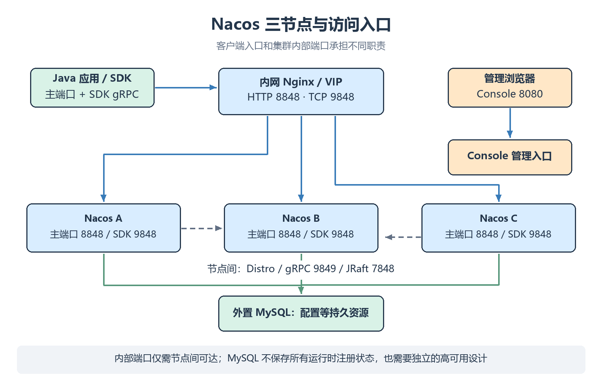

# 集群部署与外置数据库

多个 Nacos 节点配合外置数据库与内部同步协议组成集群，降低单节点故障对注册和配置能力的影响。

## 拓扑与边界

```text
Java 应用 → 内网域名 / VIP → Nacos A、B、C
                             ↕ Distro / JRaft / 节点通信
                          外置 MySQL（配置等持久资源）
管理浏览器 → Console（可独立部署）
```

本课给出**三台主机的配置**，不要求在同一台机器上同时启动三进程。配置模型与单机相同。



| 主机                                     | 主端口  | SDK gRPC | 内部 gRPC | JRaft | Console |
| -------------------------------------- | ---- | -------- | ------- | ----- | ------- |
| <code>&lt;NACOS_NODE_1_HOST&gt;</code> | 8848 | 9848     | 9849    | 7848  | 8080    |
| <code>&lt;NACOS_NODE_2_HOST&gt;</code> | 8848 | 9848     | 9849    | 7848  | 8080    |
| <code>&lt;NACOS_NODE_3_HOST&gt;</code> | 8848 | 9848     | 9849    | 7848  | 8080    |

地址为示例，替换为节点间、客户端都能访问的真实内网地址。客户端只需相应的业务入口，<code>9849</code>、<code>7848</code> 保持节点间可达。

## 外置 MySQL

使用已维护的 MySQL 版本，例如 MySQL 8.4 LTS，并验证所用发行包的 JDBC 驱动和数据源插件。为 Nacos 建立独立数据库与账号。

1. 使用 **3.2.4 对应的 MySQL 初始化 SQL**；如果发行包没有随附 <code>conf/mysql-schema.sql</code>，从同版本官方 MySQL 数据源插件源码获取。
2. 在数据库工具中创建 Nacos 专用数据库 <code>&lt;MYSQL_DATABASE&gt;</code>，执行该文件初始化表。
3. 让所有 Nacos 节点连接同一个逻辑数据库，避免每个节点各建一套不共享的数据。

已定义 <code>nacosDir</code> 为发行包目录后，可以获取固定版本的 SQL：

```bash
nacosDir='<NACOS_DIR>'
curl -fL -o "$nacosDir/conf/mysql-schema.sql" \
    'https://raw.githubusercontent.com/alibaba/nacos/3.2.4/plugin-default-impl/nacos-default-datasource-plugin/nacos-datasource-plugin-mysql/src/main/resources/META-INF/mysql-schema.sql'
```

此命令只下载 SQL，不执行数据库初始化。先检查目标数据库和账号，再在数据库工具中执行；不要拿另一版本的表结构替代。

修改各节点 <code>conf/application.properties</code>：

```properties
spring.sql.init.platform=mysql
db.num=1
db.url.0=jdbc:mysql://<MYSQL_HOST>:3306/<MYSQL_DATABASE>?characterEncoding=utf8&connectTimeout=1000&socketTimeout=3000
db.user=<MYSQL_USERNAME>
db.password=<MYSQL_PASSWORD>
```

TLS 等连接参数按数据库要求补充，不把关闭证书校验当作排错步骤。

| 误区 | 正确理解 |
| --- | --- |
| 配了 MySQL，数据库就不会单点故障 | 还需设计数据库高可用、备份与恢复 |
| Nacos 所有状态都在 MySQL | 临时注册走运行时状态，JRaft 等还有本地持久数据 |
| 单机只能使用 Derby | 单机也可使用外置 MySQL |
| 集群绝对不能用 Derby | 有内置存储集群路径；需理解 Raft，官方更推荐外置 MySQL |

## 节点列表与身份

在每个节点 <code>conf/cluster.conf</code> 中配置相同成员列表：

```text
<NACOS_NODE_1_HOST>:8848
<NACOS_NODE_2_HOST>:8848
<NACOS_NODE_3_HOST>:8848
```

在每个节点明确配置：

```properties
nacos.server.main.port=8848
nacos.core.auth.enabled=true
nacos.core.auth.admin.enabled=true
nacos.core.auth.console.enabled=true
nacos.core.auth.plugin.nacos.token.secret.key=<NACOS_TOKEN_SECRET_BASE64>
nacos.core.auth.server.identity.key=<NACOS_IDENTITY_KEY>
nacos.core.auth.server.identity.value=<NACOS_IDENTITY_VALUE>
```

所有节点的签名密钥和内部身份配置必须一致。多网卡节点可以额外指定 <code>nacos.inetutils.ip-address</code> 为本节点实际地址；成员列表中的地址必须与节点实际发布地址一致，不能填写回环地址来代替远程集群节点。

## 启动

在每台节点上，于发行包目录执行：

```bash
sh "$nacosDir/bin/startup.sh" -m cluster
```

3.2.4 脚本的集群默认 JVM 堆为 <code>2g</code>，不是单机默认的 <code>512m</code>。按资源和负载设置，不把降低内存作为生产容量规划。

只运行微服务功能可在全节点使用 <code>-f microservice</code>；它不加载 AI 模块，本课程 MCP / Prompt 实操应保留默认 <code>all</code>。

## 客户端与负载均衡

可以先用节点列表验证：

```yaml
spring:
  cloud:
    nacos:
      discovery:
        server-addr: '<NACOS_NODE_1_HOST>:8848,<NACOS_NODE_2_HOST>:8848,<NACOS_NODE_3_HOST>:8848'
      config:
        server-addr: '<NACOS_NODE_1_HOST>:8848,<NACOS_NODE_2_HOST>:8848,<NACOS_NODE_3_HOST>:8848'
```

采用域名 / VIP 时，主端口和 SDK gRPC 都要映射。SDK 按主端口 **+1000** 计算 gRPC 入口；不能仅代理 <code>8848</code>，也不能随意把两个入口映射成无关端口。

| 通路 | 代理要求 |
| --- | --- |
| HTTP 主端口 | 按 HTTP API 需要提供入口 |
| SDK gRPC | 采用官方建议的 TCP 转发，检查长连接超时 |
| Console | 独立控制访问范围；按拓扑提供入口 |
| Server 间端口 | 节点间直接可达，避免暴露到业务外网 |

## Nginx 的 HTTP 与 TCP 代理

下面是专用内网代理的最小配置示例。占位主机需要替换；Nginx 必须具备 <code>stream</code> 模块，两个客户端入口保持默认的 +1000 偏移关系。

```nginx
events {}

http {
    upstream nacos_http {
        server <NACOS_NODE_1_HOST>:8848;
        server <NACOS_NODE_2_HOST>:8848;
        server <NACOS_NODE_3_HOST>:8848;
    }
    server {
        listen 8848;
        location /nacos/ {
            proxy_pass http://nacos_http;
            proxy_http_version 1.1;
        }
    }
}

stream {
    upstream nacos_grpc {
        server <NACOS_NODE_1_HOST>:9848;
        server <NACOS_NODE_2_HOST>:9848;
        server <NACOS_NODE_3_HOST>:9848;
    }
    server {
        listen 9848;
        proxy_pass nacos_grpc;
        proxy_connect_timeout 5s;
        proxy_timeout 1h;
    }
}
```

| 事项 | 说明 |
| --- | --- |
| HTTP 路径 | 示例保留 <code>/nacos</code>，没有通过 URL 重写切换上下文 |
| SDK gRPC | <code>stream</code> 做 TCP 转发，不使用普通 HTTP location 代理 |
| 空闲超时 | <code>1h</code> 仅为示例，结合保活、上游负载均衡和实际流量验证 |
| 集群内部 | <code>9849 / 7848</code> 由节点直接通信，不混入客户端代理 upstream |
| Console | 默认 <code>8080</code> 管理入口单独配置和限制访问 |

这段配置演示协议与端口关系；TLS、访问来源约束、监控和负载均衡器自身高可用按部署要求补充。Nginx 长连接通常会固定到某个后端，不代表每个 gRPC 请求都轮询一个节点。

## 验证与备份

1. 确认所有节点看到相同成员列表，数据库连接和协议日志正常。
2. 验证注册、订阅、配置发布和动态刷新。
3. 在测试环境停止一个节点，观察客户端重连和 Redo，以及配置 / 持久路径是否可用。
4. 验证恢复节点重新加入，不把两个以上节点同时故障当作“三节点必然可用”。

备份包括数据库、节点配置和需要的协议持久数据；恢复方案必须验证。三节点多数派是协议条件，不能代替数据库、网络、VIP 和存储的完整可用性设计。

详见 [[09-通信机制与一致性原理|Distro 与 JRaft]]、[[10-运维监控与故障排查|监控与排错]]、[[14-版本升级与旧文纠偏|升级与回退]]。
