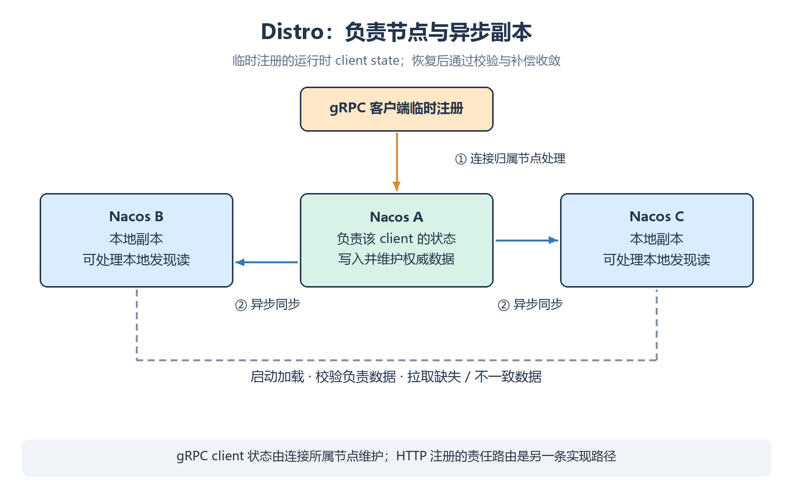
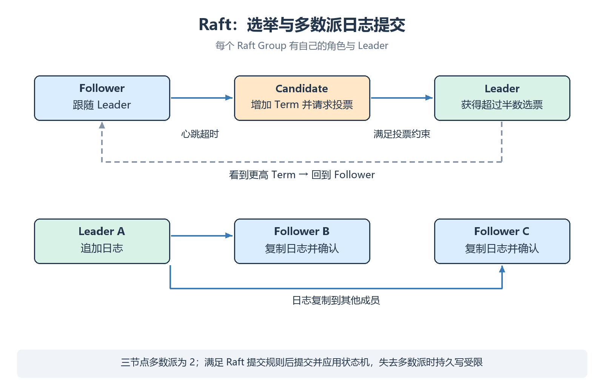
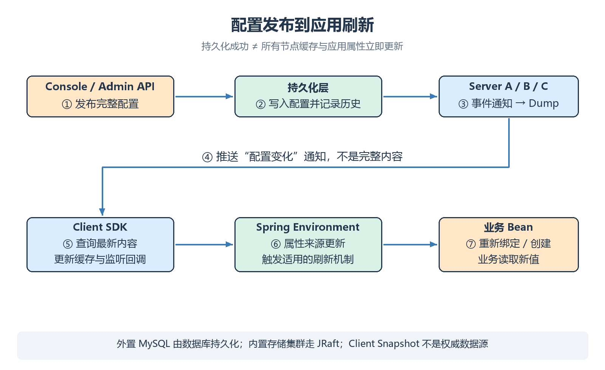

# 通信机制与一致性原理

Nacos 根据数据类型选择不同的通信、存储和一致性路径，不能用一个 AP 或 CP 标签解释所有功能。

> [!abstract]
> 本课重点：gRPC 保活；CAP / BASE 与协议分层；Distro 与 JRaft；配置传播和故障边界。

## Nacos 3 的通信入口

| 场景 | Nacos 3 的行为 | 默认入口 |
| --- | --- | --- |
| SDK 临时注册与存活 | gRPC 注册，按连接生命周期维护 | SDK gRPC <code>9848</code> |
| SDK 服务订阅 | gRPC 订阅和实例视图推送，重连 Redo | SDK gRPC <code>9848</code> |
| SDK 配置监听 | gRPC 监听，推送变更通知，再查询内容 | SDK gRPC <code>9848</code> |
| HTTP 自定义客户端 | v3 查询 / 注册；HTTP 临时实例需续约 | Server 主端口 <code>8848</code> |
| 默认鉴权插件登录 | HTTP 获取访问 Token | Server 主端口 <code>8848</code> |
| 资源发布与运维 | Admin HTTP API | Server 主端口 <code>8848</code> |
| 控制台管理 | Console 页面与 HTTP API | Console <code>8080</code> |

HTTP Client OpenAPI 不提供等同 SDK 长连接的服务订阅、配置监听能力。需要持续感知变化时使用官方 SDK，并让客户端正常完成连接、订阅与重连恢复。

HTTP 本身也可以复用 TCP 连接。gRPC 的收益主要来自长连接上的双向通信、统一请求模型和较低的重复通信开销，不宜概括为“每次 HTTP 一定创建和销毁连接”。

## 长连接承担什么

```text
SDK ↔ Server：建立 gRPC 连接
SDK → Server：注册 / 订阅 / 读取配置 / 上报监听状态
Server → SDK：实例视图 / 配置变更通知
连接失效 → 重连 → 恢复注册与订阅意图
```

服务推送通常包含新的发现视图；配置推送主要通知某个资源发生变化，由客户端再读取配置。两种推送内容不同。

长连接提高通信效率，但推送与客户端回调仍可能失败。SDK 的缓存、重试、重新查询与 Redo 承担恢复任务，业务代码也需处理无可用实例、解析失败和调用超时。

## 注册、保活与 Redo 的分工

| 阶段 | 当前 SDK / Server 的行为 | 边界 |
| --- | --- | --- |
| 应用启动 | Spring 注册适配器调用 NamingService，SDK 发送 gRPC 注册请求 | 不是 Console 页面自动发现进程 |
| 注册成功 | 记录实例，并保留需要恢复的临时注册意图 | Redo 记录不是持久服务的权威存储 |
| 连接保活 | SDK 与服务端检查连接健康，服务端维护连接活跃状态与检查 / 清理任务 | 业务没有请求不等于业务已经故障 |
| 连接异常 | 重连；服务端感知失效后清理连接关联的运行态 | 清理时机不是所有异常下的瞬时动作 |
| 重连成功 | 根据 Redo 恢复临时注册、订阅等意图 | 必须检查恢复请求是否成功 |

3.2.4 的 <code>ConnectionManager</code> 调度运行时连接检查 / 清理，由具体策略处理失活连接。检查周期、超时阈值和断连判定按当前系统参数与运行时策略核对。

HTTP 临时实例依赖续约；gRPC 临时实例依赖连接状态。它们与持久实例的 TCP / HTTP / MySQL 主动健康检查是不同机制。

## CAP 的适用范围

CAP 讨论的是**发生网络分区时**，分布式系统怎样在一致性与可用性之间取舍。这里的一致性指严格的数据可见性约束；可用性也不是日常“服务在线率”的同义词。

| 数据 / 路径 | 主要机制 | 理解方式 |
| --- | --- | --- |
| 临时注册的运行时 client state | Distro | 偏 AP，通过异步同步收敛 |
| 持久服务资源 | JRaft | 偏 CP，持久写入依赖对应 Raft 路径 |
| 外置 MySQL 的配置持久化 | 数据库事务 + 节点通知 / Dump | 权威数据在数据库，读取缓存异步刷新 |
| 内置存储集群的配置写入 | JRaft + 内置数据库 | 数据写入依赖 Raft 多数派与状态机 |

“配置中心是 CP”可以作为粗略分类，但不能推出“每次发布都让每个 Server 节点同步写数据库”或“所有客户端立即看到新值”。必须继续看具体存储和通知路径。

## BASE 与最终一致性

| 概念 | 含义 | 需要的条件 |
| --- | --- | --- |
| Basically Available | 故障期间保留部分可用能力 | 接受某些功能降级或暂时失败 |
| Soft State | 允许传播过程中的临时状态差异 | 区分本地视图与权威数据 |
| Eventually Consistent | 更新停止、通信恢复且补偿有效后逐步收敛 | 必须有同步、校验、冲突处理和恢复机制 |

BASE 是描述设计取舍的思路，不是某个具体协议，也不承诺“等一段固定时间必然一致”。CAP 的 C 与日常泛称的最终一致性不能混为一谈。

## 一致性能力如何分层

| 边界 | 当前实现入口 / 概念 | 作用 |
| --- | --- | --- |
| 协议抽象 | <code>ConsistencyProtocol</code> 的读写、处理器和就绪等契约 | 表达协议层操作与状态 |
| 协议管理 | <code>ProtocolManager</code> | 初始化 AP / CP 协议并感知成员变化 |
| 具体协议 | <code>DistroProtocol</code> / <code>JRaftProtocol</code> | 同步运行时状态或协调持久操作 |
| 数据处理 | client state 处理器、配置 repository 和数据源插件 | 把业务数据接入相应状态 / 存储路径 |

分层减少业务与协议实现细节的耦合，不代表任意业务读写都自动具有相同的一致性。普通应用通过 Nacos 3 SDK / API 接入；内部状态处理、协议协调和数据源实现由服务端负责。

JRaft 复用成熟的 Java Raft 实现并支持多个 Group；Distro 更适合可由客户端恢复的临时运行态异步同步。选择来自数据生命周期与可用性要求，不是通过一个开关把整个 Nacos 任意切成 AP 或 CP。

## Distro 的核心流程

1. 确定运行时客户端状态的负责节点；gRPC 状态由连接所属节点维护。
2. 负责节点处理注册变更，维护 client state；v3 HTTP 注册按其对应的状态维护与责任路由路径处理。
3. 负责节点把变化异步同步给其他节点。
4. 节点间通过校验与补偿修复遗漏，启动时加载必要数据。

Distro 不靠选出单一全局 Leader 维护所有临时实例。分区期间不同节点可能持有不同视图；恢复后继续同步和收敛。



| 场景 | 主要动作 | 对外理解 |
| --- | --- | --- |
| 启动加载 | 获取所需运行时状态快照并应用 | 新节点要先完成初始化，不是只创建空注册表 |
| 负责数据变化 | 发送增量变化 / 删除，失败时按任务机制补偿 | 写入本节点与其他节点更新有传播间隔 |
| 周期校验 | 比较负责数据的校验信息，发现缺失或差异后同步 / 拉取 | 校验不是每次都完整复制所有业务数据 |
| 本地发现读 | 从节点已有服务视图读取 | AP 副本读可能在分区或传播期间过期 |

gRPC client state 的归属与连接所在节点有关。查看 Nacos 3 注册路径时，分别检查 gRPC 请求处理、v3 HTTP 注册处理和集群内部同步请求。

> [!note]
> “多个节点能处理请求”不等于“每个节点都独立负责同一份数据”。数据归属、转发与副本读取是不同问题。

## JRaft 的核心流程

```text
持久写入 → 对应 Raft Group 的 Leader
         → 复制日志 → 多数派确认 → 提交并应用状态机
```

| 概念 | 含义 |
| --- | --- |
| Leader | 当前 Raft Group 的写入协调者 |
| Term | 选举任期，用于识别新旧 Leader |
| 日志复制 | 把操作复制到其他成员 |
| 多数派 | 3 节点需要至少 2 节点形成多数派 |
| Snapshot | 压缩日志并帮助状态恢复 |

Nacos 内部可以有多个 Raft Group，不应说“整个 Nacos 只有一个 Leader”。一次持久写入成功，也不能直接推导任意缓存读都具有线性一致性。



| 过程 | 关键规则 |
| --- | --- |
| 选举触发 | Follower 在选举超时后进入 Candidate，增加 Term 并请求投票 |
| 投票约束 | 每个节点每个 Term 最多投一票；候选日志需要足够新 |
| 获得多数票 | 成为该 Group 的 Leader，发送心跳并协调复制 |
| 更高 Term | 旧 Candidate / Leader 回到 Follower |
| 日志复制 | 跟随者匹配前置日志，修正不一致部分并确认复制 |
| 提交与应用 | 满足 Raft 提交规则后推进提交位置，再应用到状态机 |

随机选举超时用于降低候选人同时竞争的概率。复制到多数派是重要条件，但不能忽略任期等提交规则；客户端超时也不自动证明这次写入一定没有被提交，重试要考虑幂等性。

3.2.4 为 JRaft 原生 gRPC 增加 Server identity 校验；即使客户端鉴权关闭，集群内部身份仍必须一致。详见 [[14-版本升级与旧文纠偏|升级限制]]。

## 配置发布到应用的链路

```text
控制台 / Admin API
    → 持久化层写入并记录历史
    → 配置变更事件与节点通知
    → 各节点加载配置，更新缓存和 Dump
    → 通知监听客户端
    → SDK 拉取内容，更新本地状态
    → Spring 刷新适用的 Bean / 属性
```

持久化层是权威数据源，Server Dump 是读取缓存，Client Snapshot 是最后已知配置。发布成功后，节点缓存和应用刷新可能有传播延迟。



## 故障时能做什么

| 故障 | 可利用的恢复能力 | 仍存在的边界 |
| --- | --- | --- |
| 某个 Server 节点故障 | SDK 切换节点、重连 Redo | 恢复期间可能请求失败 |
| SDK 与集群断网 | 本地缓存 / Snapshot | 无法得到新地址和新配置，旧地址可能失效 |
| 失去 Raft 多数派 | 既有缓存可能仍可读 | 对应 CP 写路径不能正常提交 |
| 外置数据库故障 | 已加载的配置缓存 | 新的配置发布等数据库操作受影响 |
| 配置回调异常 | 重试和应用自身校验 | 不能保证每个业务对象已经生效 |

详见 [[03-服务模型与实例生命周期|实例生命周期]]、[[08-集群部署与外置数据库|集群部署]]、[[10-运维监控与故障排查|故障排查]]、[[分布式基础|分布式基础]]。
